# Pulz

Live, real-time quiz platform (Kahoot!-style). Host runs a synchronous quiz
session; players join from any device via a short join code, answer on a
color/shape button grid, and see live scoring.

See:
- [`CLAUDE.md`](CLAUDE.md) — orientation for any agent/contributor picking
  this up
- [`docs/PRD.md`](docs/PRD.md) — product requirements, scope, flows
- [`docs/DESIGN.md`](docs/DESIGN.md) — domain model, state machine, event
  surface
- [`docs/ARCHITECTURE.md`](docs/ARCHITECTURE.md) — tech stack and infra
  choices, with reasoning
- [`docs/DESIGN_SYSTEM.md`](docs/DESIGN_SYSTEM.md) — the visual system:
  palette, typography, components, motion
- [`docs/DECISIONS.md`](docs/DECISIONS.md) — quick-reference log of
  settled decisions
- [`docs/OBSERVABILITY.md`](docs/OBSERVABILITY.md) — monitoring on Grafana
  Cloud: what's collected, setup runbook, alerts
- [`docs/GO_V2_EXPLORATION.md`](docs/GO_V2_EXPLORATION.md) — scope of the
  `backend-go/` performance exploration (not the MVP backend)
- [`docs/FRONTEND_PLAN.md`](docs/FRONTEND_PLAN.md) — frontend plan,
  settled decisions and progress checklist.

## Layout

- [`backend/`](backend/) — the real MVP backend (Node.js/TypeScript,
  Fastify + Socket.IO + Prisma/Postgres): Creator auth and quiz CRUD,
  session creation, the full realtime game loop, and results. See
  `CLAUDE.md` for current status and next steps.
- [`backend-go/`](backend-go/) — **not** the MVP backend. A separate,
  low-priority Go performance-exploration module; see
  `docs/GO_V2_EXPLORATION.md`.
- [`frontend/`](frontend/) — React + Vite SPA. All eight routes (Home,
  Creator flows, Host, Display, Join/Play, Results) are implemented, including the
  Creator→session hand-off. Manually verified end-to-end against a live
  backend and covered by three Playwright E2E tests. See
  `docs/FRONTEND_PLAN.md`.

**Status:** MVP backend implemented and verified end-to-end (unit and real-socket
tests); frontend's full user journey (create → start session →
host/display/play → results) is implemented, manually verified
end-to-end, and covered by an automated Playwright E2E suite, which is stable
(Decision #59 fixed the earlier flakiness). Metrics, traces and logs go to
Grafana Cloud once configured (`docs/OBSERVABILITY.md`); not yet deployed.
See [Run it locally](#run-it-locally) below to start it,
`docs/FRONTEND_PLAN.md` for the frontend plan, and `CLAUDE.md` for the full
up-to-date picture.

## Run it locally

### Prerequisites

- **Docker Desktop** (or Docker Engine with the Compose plugin)
- **Node.js 20+** and npm (only needed for `make dev`, the demo seeder and the tests)
- **make** (preinstalled on macOS and most Linux distributions)

### Quick start (one command)

```bash
make up
```

This builds and starts Postgres, the backend and the frontend in Docker,
applies database migrations, and waits until both servers answer. Then open:

- App: <http://localhost:5173>
- Backend API: <http://localhost:3000> (health check at `/health`)

Code changes hot-reload; the repo is mounted into the containers. Stop with
`make down` (keeps the database) or `make clean` (also deletes it).

### Try a game with dummy questions

With the stack running:

```bash
make demo
```

It creates an 8-question quiz, starts a live session, and prints the join
code plus the Host and Display links. Open the Host link in one window and
the Display link in another, then join as players at
<http://localhost:5173/join>, one player per browser or browser profile (tabs
in one browser share storage). Sessions live in the backend's memory, so after
a backend restart just run `make demo` again.

### All make targets

| Command | What it does |
| --- | --- |
| `make up` | Start everything in Docker and wait until it's ready |
| `make observe` | Like `make up`, plus a local Grafana at <http://localhost:3001> showing the backend's metrics, traces and logs ([`docs/OBSERVABILITY.md`](docs/OBSERVABILITY.md)) |
| `make down` | Stop the Docker stack (keeps the database) |
| `make restart` | `down` then `up` |
| `make logs` | Follow logs from all containers |
| `make ps` | Show container status |
| `make dev` | Run backend + frontend as local Node processes (Postgres stays in Docker); Ctrl-C stops both |
| `make install` | `npm install` in `backend/` and `frontend/` |
| `make demo` | Seed a playable quiz and print the links |
| `make test` | Backend + frontend unit tests |
| `make typecheck` | Typecheck backend and frontend |
| `make e2e` | Playwright end-to-end suite against the running stack |
| `make clean` | Stop the stack and delete the database volume |

`make` on its own prints this list.

### Native mode (`make dev`)

`make dev` runs the backend (`tsx watch`) and frontend (Vite) directly on your
machine, with only Postgres in Docker. It starts faster and gives quicker
reloads than the all-Docker stack. It installs dependencies on first run,
applies migrations, and interleaves both log streams with `[backend]` /
`[frontend]` prefixes. Without a `backend/.env` it uses the same dev settings
as `docker-compose.yml`; copy `backend/.env.example` to `backend/.env` to
customise them.

`make up` and `make dev` both use ports 3000 and 5173, so run one at a time:
`make down` before `make dev`.

### Without make

```bash
docker compose up --build          # full stack in Docker; Ctrl-C to stop
cd backend && npm run demo         # in a second terminal: seed a game
```

### Tests

```bash
make test        # unit tests (backend Vitest + frontend Vitest)
make e2e         # Playwright E2E; needs `make up` running first
```

The E2E suite runs against the Docker stack. The dev stack raises
`POST /auth/register`'s 10/hour-per-IP production limit so the suite can be
re-run freely (Decision #60). See `docs/FRONTEND_PLAN.md` for more.

### Troubleshooting

- **"Port … is already in use"**: another copy of the stack is running.
  `make down` stops the Docker one; for a local Postgres on 5432, stop it or
  change the port mapping in `docker-compose.yml`.
- **Backend never becomes ready**: `make logs` shows why. A stale database
  from an older schema can be reset with `make clean && make up`.
- **E2E tests fail to install browsers**: run
  `cd frontend && npx playwright install chromium` once.

## Screenshots

The visual system (palette, type, components, motion) is documented in
[`docs/DESIGN_SYSTEM.md`](docs/DESIGN_SYSTEM.md).

| Home | Home (dark mode) |
| --- | --- |
| 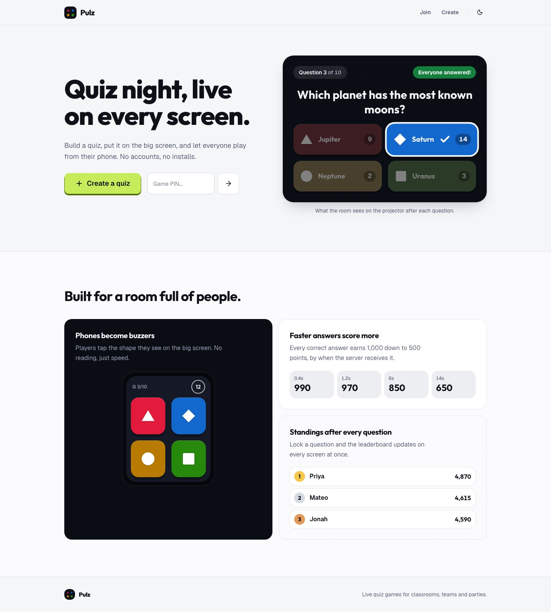 | 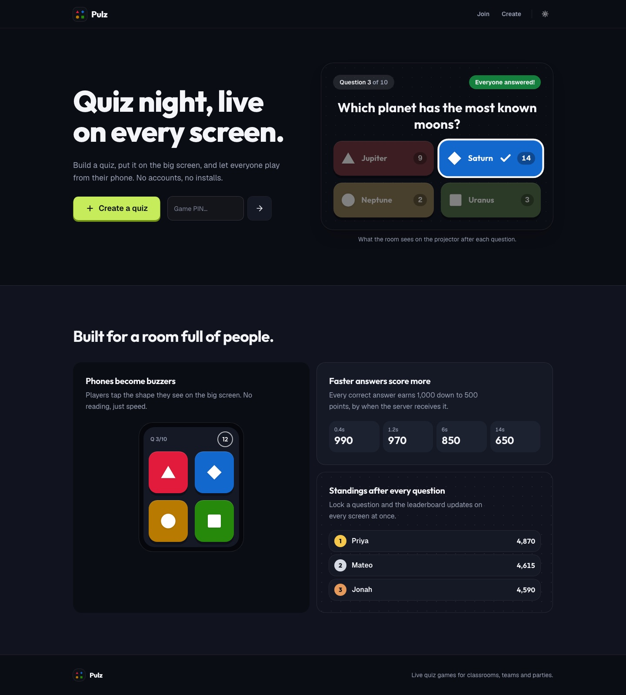 |

| Create | Create (dark mode) |
| --- | --- |
| 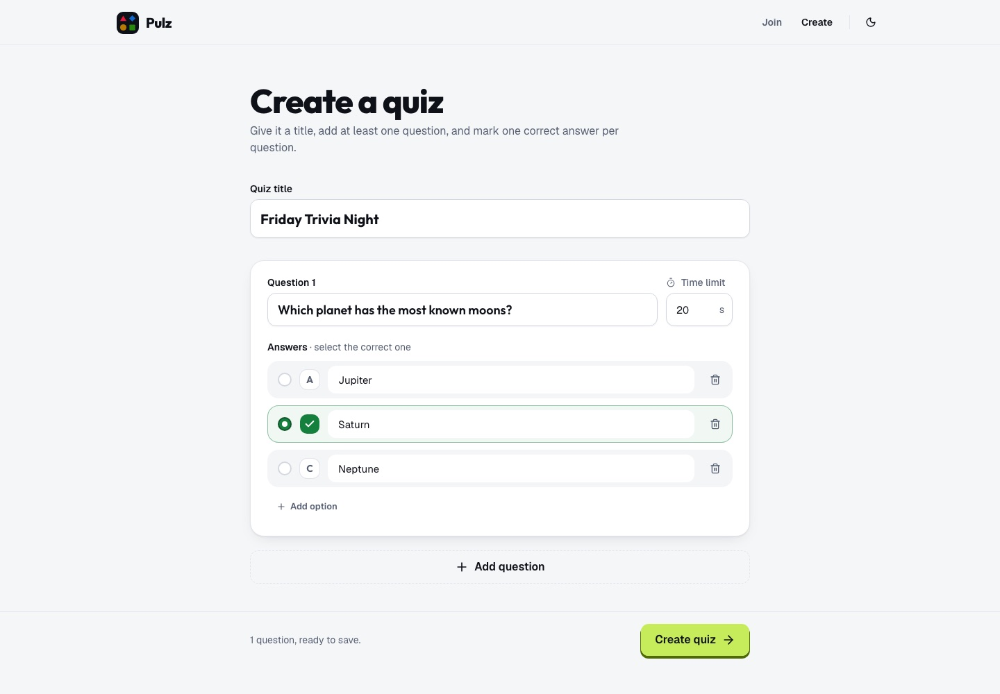 | 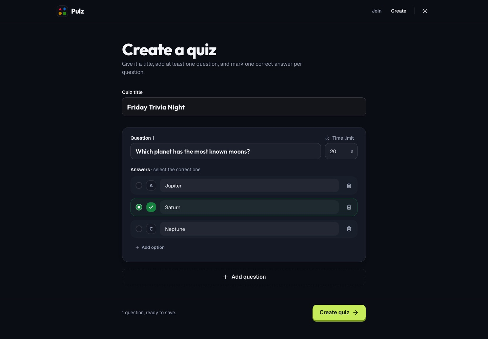 |

| Edit + start session |
| --- |
| 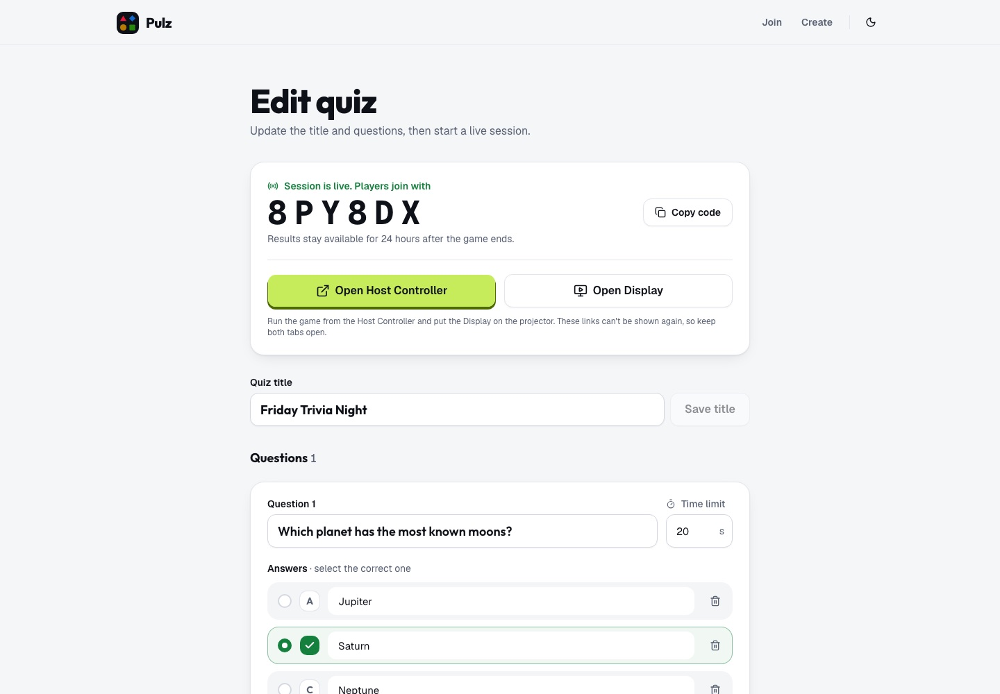 |

| Join | Host controller |
| --- | --- |
| 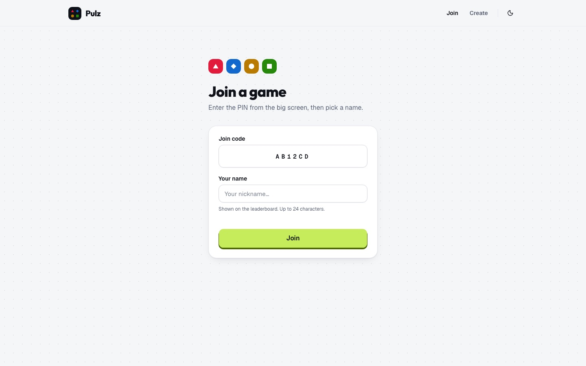 | 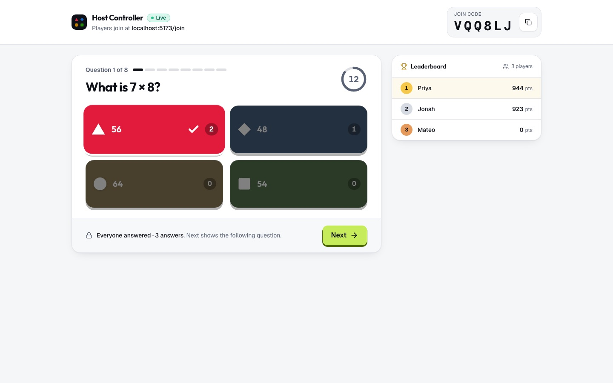 |

| Display — lobby | Display — question |
| --- | --- |
| 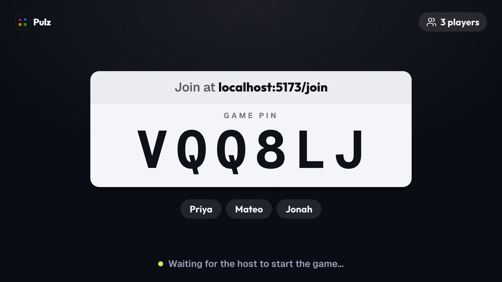 | 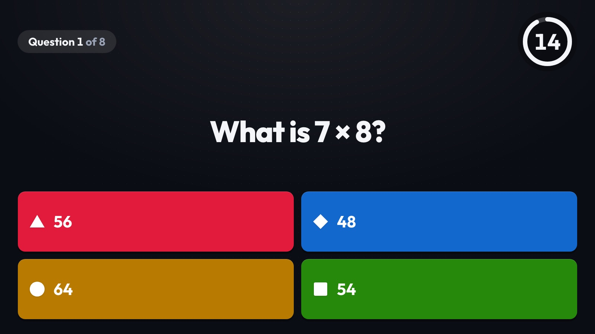 |

| Display — reveal + leaderboard | Display — podium |
| --- | --- |
| 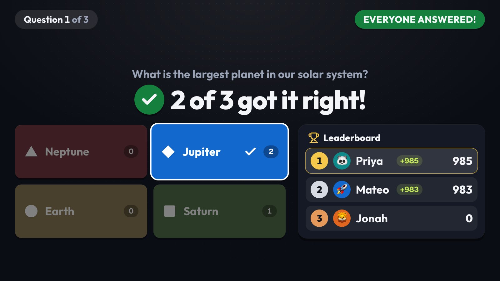 | 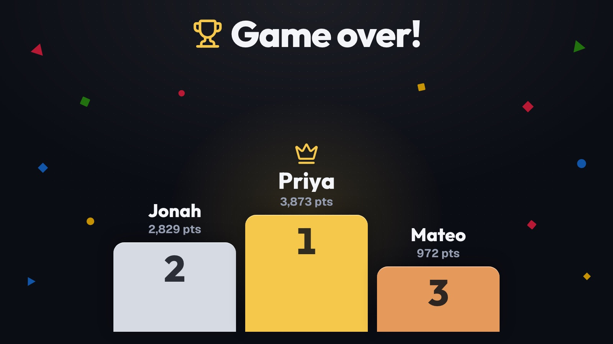 |

| Play (phone) — question | Play (phone) — result |
| --- | --- |
| 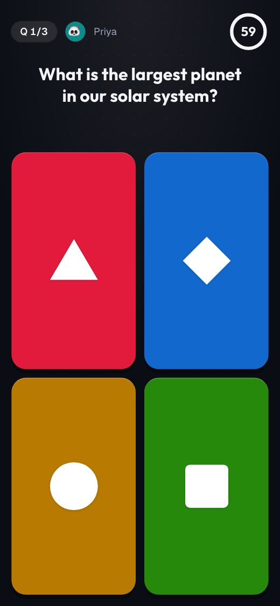 | 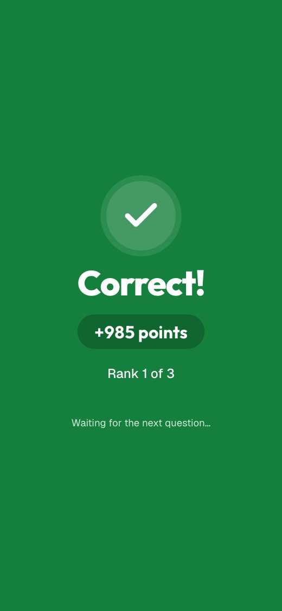 |

| Results (phone) |
| --- |
| 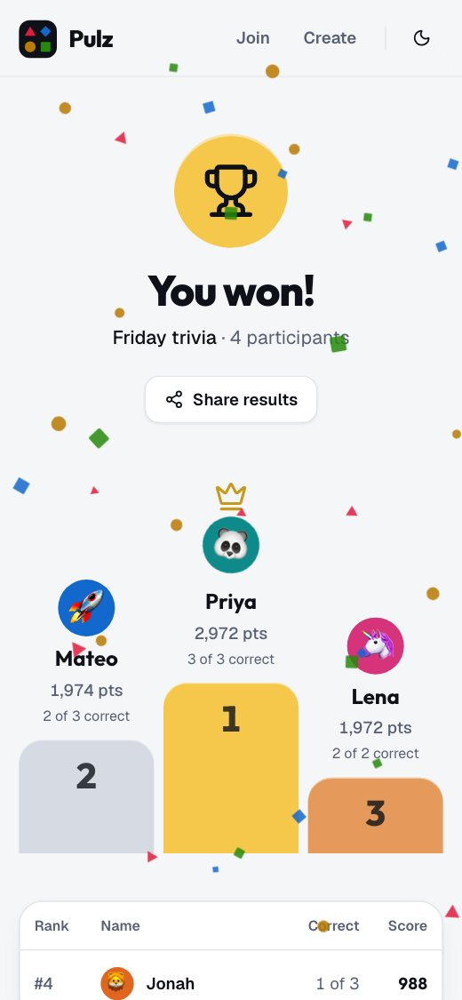 |

| Observability: the Pulz overview dashboard (`make observe`) |
| --- |
| 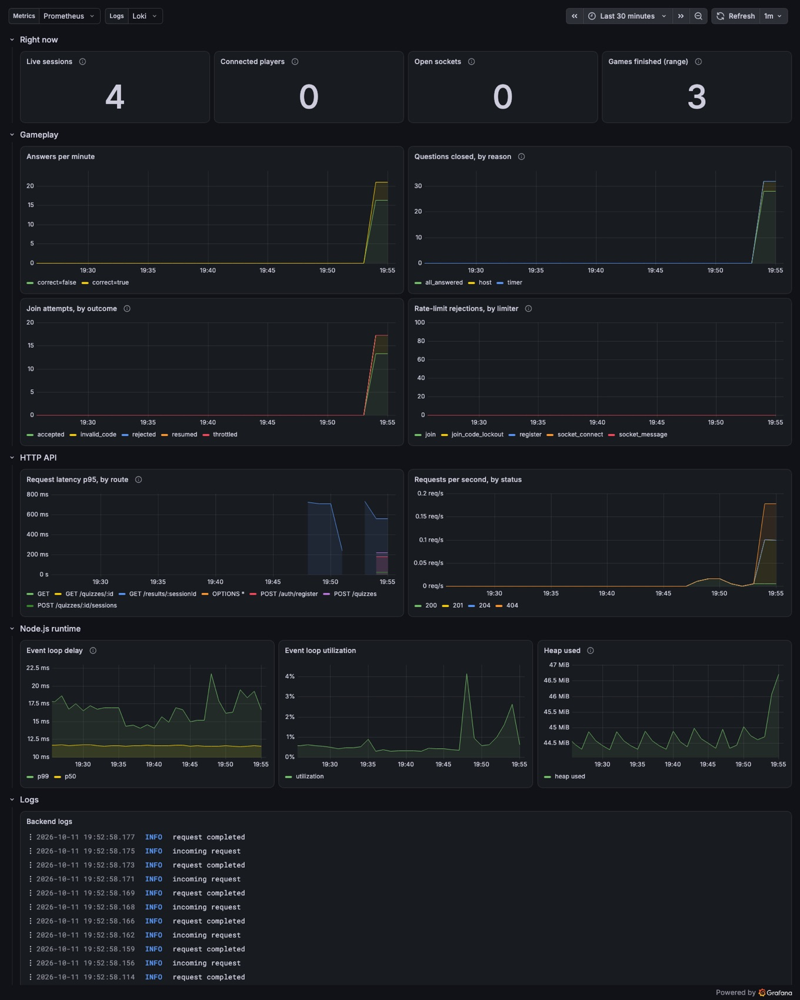 |
